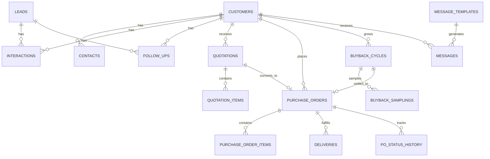

# Saung Lele CRM — Design Document

**Versi:** 1.0 · **Tanggal:** 21 Oktober 2026  
**Produk:** CRM untuk usaha ternak dan jual beli lele  
**Segmen utama:** Dapur MBG (Makan Bergizi Gratis) dan Kolam Pembesaran  
**Status:** Draft desain untuk validasi pemilik usaha

---

## 1. Ringkasan Eksekutif

Saung Lele membutuhkan CRM yang bukan sekadar buku kontak. Masalah utamanya adalah **pelanggan hilang setelah transaksi** dan **follow-up yang tidak terlacak**. CRM ini dirancang sebagai satu tempat kerja untuk:

1. Menyimpan profil pelanggan, lead, dan seluruh riwayat interaksi.
2. Mengubah catatan menjadi pengingat follow-up yang tidak mudah terlewat.
3. Mengirim pesan WhatsApp yang konsisten melalui template per kategori.
4. Membuat quotation yang sesuai segmen: produk siap masak/fillet untuk Dapur MBG, bibit untuk Kolam Pembesaran.
5. Menerima PO dan memantau progresnya sampai barang diterima pelanggan.
6. Mengelola siklus buyback hasil panen mitra kolam, dari tebar bibit sampai pembayaran.

Prinsip desainnya: **satu layar untuk tahu siapa yang harus dihubungi hari ini, dan satu klik untuk menghubunginya.**

### Metrik keberhasilan

| Metrik | Baseline (asumsi) | Target 6 bulan |
|---|---:|---:|
| Follow-up terlambat | Tidak terukur | < 5% dari total follow-up |
| Repeat order Dapur MBG | 45% | ≥ 65% |
| Pelanggan berisiko churn | Tidak terukur | Turun 30% |
| Waktu konfirmasi PO | > 1 hari | < 4 jam kerja |
| On-time delivery | Tidak terukur | ≥ 95% |
| Quotation → PO conversion | Tidak terukur | ≥ 40% |

---

## 2. Konteks & Masalah

### Yang terjadi saat ini

- Data pelanggan tersebar di WhatsApp, buku catatan, dan ingatan pemilik.
- Follow-up bergantung pada siapa yang ingat, bukan pada sistem.
- Tidak ada riwayat lengkap: pernah ditawari apa, harga berapa, kapan terakhir order.
- Pesan ke pelanggan ditulis ulang dari nol, sehingga nada dan informasinya tidak konsisten.
- Quotation dibuat manual, rawan salah hitung dan sulit dilacak statusnya.
- PO masuk lewat WhatsApp, lalu progres produksi/pengiriman dipantau manual.
- Mitra kolam tidak terpantau setelah bibit dikirim; peluang buyback dan repeat order hilang.

### Kebutuhan inti

> “Saya ingin tahu siapa yang harus saya hubungi hari ini, apa yang terakhir saya janjikan, dan apa yang harus saya tawarkan berikutnya — tanpa mencari-cari chat lama.”

---

## 3. Segmen Pelanggan & Model Penawaran

CRM harus memahami bahwa dua segmen ini punya siklus dan bahasa penawaran yang berbeda.

| Aspek | Dapur MBG | Kolam Pembesaran |
|---|---|---|
| Profil | SPPG / dapur produksi makanan bergizi | Petani/mitra pemilik kolam |
| Kebutuhan | Pasokan rutin, kualitas stabil, ukuran seragam, pengiriman terjadwal | Bibit sehat, harga kompetitif, pendampingan, kepastian buyback |
| Produk | Lele siap masak bersih, fillet lele | Bibit 2–3 cm, 3–5 cm, 5–7 cm |
| Siklus keputusan | Cepat–menengah; butuh sample, harga, dan jadwal | Menengah–panjang; butuh survey, kepercayaan, dan hitungan usaha |
| Frekuensi transaksi | Mingguan / 2× per minggu | Per siklus (60–90 hari) + buyback |
| Risiko utama | Kehabisan stok, kualitas tidak konsisten, pengiriman telat | Bibit mati, pertumbuhan lambat, harga buyback tidak sesuai |
| Nilai tambah CRM | Repeat order, health score, jadwal kirim, reminder follow-up | Siklus panen, sampling, pengingat buyback, win-back |
| Aksi khas | Buat quotation → PO → delivery | Kirim bibit → pantau pembesaran → buyback |

### Model penawaran

**Dapur MBG**

1. Lead masuk dari relasi, dinas, atau referensi SPPG.
2. Follow-up awal: profil dapur, kapasitas porsi, kebutuhan per minggu.
3. Tawarkan sample atau quotation untuk **ikan siap masak** dan **fillet**.
4. Setelah PO, buat jadwal pengiriman rutin.
5. Jaga hubungan dengan follow-up kualitas dan penawaran menu berikutnya.

**Kolam Pembesaran**

1. Lead masuk dari petani sekitar, grup WhatsApp, atau referensi mitra.
2. Survey lokasi/kolam: luas, jumlah kolam, sumber air, pengalaman.
3. Tawarkan bibit sesuai ukuran dan padat tebar.
4. Kirim bibit → otomatis membuat siklus pembesaran.
5. Follow-up berkala: sampling pertumbuhan, kualitas air, pakan.
6. Mendekati panen: jadwalkan buyback, timbang, grading, bayar.
7. Setelah buyback: tawarkan bibit siklus berikutnya (repeat).

---

## 4. Tujuan Produk

### Tujuan bisnis

- Menekan kehilangan pelanggan dengan visibilitas kesehatan pelanggan.
- Meningkatkan repeat order melalui follow-up terjadwal.
- Mempercepat quotation dan PO.
- Memberi pemilik gambaran pipeline dan operasi dalam satu dashboard.

### Tujuan pengguna

- Sales tahu prioritas harian tanpa membuka banyak chat.
- Pemilik bisa melihat pelanggan mana yang perlu perhatian.
- Admin bisa memproses PO dan delivery dengan status yang jelas.
- Semua janji ke pelanggan tercatat dan dapat ditindaklanjuti.

### Non-goals (versi awal)

- Bukan sistem akuntansi penuh (invoice/pembayaran hanya ringkas).
- Bukan sistem inventory mendalam (stok hanya snapshot).
- Bukan marketplace.
- Belum ada otomasi AI untuk membalas chat pada MVP.

---

## 5. Alur Bisnis End-to-End

### 5.1 Dapur MBG

```
Lead masuk
  → Kontak awal (≤ 24 jam)
  → Kualifikasi kebutuhan (porsi, volume, jadwal)
  → Sample / presentasi
  → Quotation (ikan siap masak / fillet)
  → Follow-up quotation (H+2, H+5)
  → PO diterima
  → Konfirmasi & produksi
  → QC & packing
  → Pengiriman
  → Konfirmasi diterima
  → Follow-up kualitas (H+1)
  → Repeat order / jadwal rutin
```

### 5.2 Kolam Pembesaran

```
Lead masuk
  → Kontak awal
  → Survey kolam
  → Quotation bibit
  → PO bibit
  → Pengiriman bibit
  → Siklus pembesaran dibuat otomatis
  → Follow-up & sampling (H+30, H+60)
  → Mendekati panen (H-14)
  → Jadwal buyback
  → Timbang & grading
  → Pembayaran
  → Tawarkan bibit siklus berikutnya
```

### 5.3 Status perjalanan pelanggan

| Status | Definisi | Aksi sistem |
|---|---|---|
| Lead | Belum pernah transaksi | Masuk pipeline, SLA kontak 24 jam |
| Prospect | Sudah ada quotation/penawaran | Reminder follow-up otomatis |
| Aktif | Ada transaksi dalam 60 hari | Jadwal follow-up rutin |
| Perlu perhatian | 60–89 hari tanpa transaksi | Masuk daftar at-risk |
| Berisiko | ≥ 90 hari tanpa transaksi | Notifikasi win-back |
| Churn | Tidak ada respons/order setelah win-back | Masuk laporan churn |

> Untuk mitra kolam, “transaksi” mencakup pembelian bibit dan buyback. Karena siklusnya panjang, status dihitung dari aktivitas siklus, bukan hanya order.

---

## 6. Arsitektur Informasi

```
Dashboard
Pelanggan
  ├─ Daftar pelanggan
  └─ Detail pelanggan
      ├─ Ringkasan & timeline
      ├─ Follow-up
      ├─ Quotation
      ├─ PO
      ├─ Buyback
      └─ Dokumen
Pipeline Lead
Template Pesan
Quotation
Pesanan (PO)
  └─ Detail PO & progres
Buyback Panen
Laporan
```

Navigasi memakai sidebar dengan pengelompokan: **Utama, Pelanggan, Komunikasi, Penjualan, Kemitraan, Analitik**. Di mobile, sidebar menjadi drawer.

---

## 7. Fitur Detail

### 7.1 Dashboard — “Hari ini harus menghubungi siapa?”

**Tujuan:** memberi prioritas harian, bukan sekadar angka.

Blok utama:

1. **KPI**: follow-up hari ini, pelanggan aktif, nilai pipeline, PO berjalan, repeat order.
2. **Follow-up hari ini**: daftar tugas dengan nama pelanggan, segmen, catatan terakhir, tenggat, status terlambat, dan tombol WhatsApp.
3. **Kesehatan pelanggan**: donut Aman / Perlu perhatian / Berisiko.
4. **Pipeline mini**: jumlah lead dan nilai per tahap.
5. **PO dalam progres**: nomor PO, pelanggan, item, nilai, status, ETA.
6. **Performa segmen** dan **aktivitas terbaru**.

Aturan:

- Follow-up terlambat selalu tampil paling atas dengan warna amber/merah.
- Klik nama pelanggan → detail; klik WA → buka template yang relevan.
- Angka KPI dapat difilter berdasarkan rentang tanggal.

### 7.2 Pelanggan & Lead

**Profil pelanggan** menyimpan:

- Identitas: nama usaha, segmen, status, sumber, pemilik (sales), alamat, koordinat.
- Kontak PIC: nama, jabatan, nomor WhatsApp, email, preferensi komunikasi.
- Profil Dapur MBG: kapasitas porsi/hari, jadwal produksi, jendela pengiriman, sertifikasi, preferensi produk, volume rata-rata.
- Profil Kolam: luas kolam, jumlah kolam, sumber air, kapasitas tebar, pengalaman, target ABW, kesepakatan buyback.
- Komersial: termin pembayaran, harga khusus, minimum order, catatan.
- Hubungan: health score, order terakhir, LTV, follow-up berikutnya, tag.

**Lead** memiliki tahap pipeline dan wajib punya *next action*. Lead tidak boleh “menggantung” tanpa tanggal follow-up.

### 7.3 Catatan, Timeline & Follow-up

Setiap interaksi (telepon, WhatsApp, kunjungan, catatan) disimpan ke timeline. Saat mencatat, pengguna dapat langsung menentukan:

- tanggal & waktu follow-up berikutnya,
- prioritas,
- penanggung jawab,
- hasil interaksi.

Sistem membuat **task follow-up** otomatis. Task bisa diselesaikan, ditunda (snooze), atau dibatalkan.

**Aturan pengingat:**

| Konteks | Waktu pengingat |
|---|---|
| Lead baru | 24 jam setelah masuk |
| Quotation terkirim | H+2 dan H+5 |
| Quotation mendekati kedaluwarsa | H-1 |
| PO baru | 4 jam kerja |
| PO siap kirim | H-1 jadwal kirim |
| Pelanggan MBG aktif | Setiap 7 hari |
| Mitra kolam fase pembesaran | Setiap 14 hari |
| Sampling kolam | Hari ke-30 dan ke-60 |
| Mendekati panen | H-14 |
| Buyback selesai | H+3 untuk follow-up bibit berikutnya |
| Pelanggan pasif | H+30, H+60, H+90 |

Notifikasi muncul di dalam aplikasi; opsional dikirim ke WhatsApp pemilik/sales.

### 7.4 Template Pesan & WhatsApp

Template dikelompokkan berdasarkan konteks:

1. Follow-up
2. Penawaran
3. Quotation
4. Konfirmasi PO
5. Produksi & pengiriman
6. Buyback
7. Pembayaran
8. Ucapan & retensi
9. Win-back

Setiap template punya: nama, kategori, segmen, isi pesan, variabel, lampiran opsional, status aktif, dan jumlah pemakaian.

**Variabel:** `{{nama}}`, `{{nama_usaha}}`, `{{produk}}`, `{{qty}}`, `{{harga}}`, `{{tanggal_kirim}}`, `{{no_po}}`, `{{no_quotation}}`, `{{nama_sales}}`, `{{link_quotation}}`.

**Contoh template follow-up quotation:**

> Selamat pagi Bapak/Ibu {{nama}}, saya {{nama_sales}} dari Saung Lele. Quotation {{no_quotation}} untuk {{produk}} sudah saya kirimkan. Apakah ada yang ingin disesuaikan sebelum kami siapkan jadwal kirim? Terima kasih.

**Contoh template buyback:**

> Halo Bapak {{nama}}, berdasarkan sampling terakhir, ikan di kolam Bapak sudah mendekati ukuran panen. Kami ingin menjadwalkan buyback pada {{tanggal}}. Apakah hari itu cocok? Kami akan bawa tim timbang dan grading.

**Strategi integrasi WhatsApp:**

- **Fase 1 (MVP): klik-untuk-chat.** Sistem membuka `wa.me` dengan pesan terisi. Pengguna mengirim dari WhatsApp, lalu menandai “sudah terkirim”; pesan dicatat ke timeline. Tidak perlu verifikasi Meta.
- **Fase 2: WhatsApp Business Cloud API.** Pesan terkirim langsung dari sistem, status delivered/read masuk otomatis, inbox terpusat. Perlu nomor bisnis, verifikasi Meta, dan template yang disetujui.

**Aturan komunikasi:**

- Hanya kirim ke kontak yang sudah opt-in.
- Jam tenang 20.00–08.00.
- Maksimal 1 follow-up per pelanggan per hari (kecuali percakapan aktif).
- Semua pesan tercatat; pesan gagal masuk antrean.
- Sediakan opt-out dan alasan berhenti.

### 7.5 Quotation

**Tujuan:** membuat penawaran cepat, akurat, dan bisa langsung dikirim.

Fitur:

- Pilih pelanggan → segmen otomatis menentukan katalog produk.
- Nomor otomatis: `QUO/YYMM/NNN`.
- Item: produk, grade/ukuran, qty, satuan, harga, diskon, subtotal.
- Biaya kirim, pajak (default PPN 11%, dapat diubah), total.
- Masa berlaku: 7 hari untuk produk segar, 14 hari untuk bibit.
- Catatan dan syarat pembayaran.
- Simpan draft, kirim via WhatsApp, unduh PDF.
- Status: Draft, Terkirim, Diterima, Ditolak, Kedaluwarsa, Revisi.
- Quotation diterima → tombol “Buat PO” menyalin item.
- Follow-up otomatis H+2 dan H+5.

**Aturan approval (asumsi):**

- Diskon > 5% atau total > Rp 10 juta memerlukan persetujuan pemilik.
- Harga di bawah price list memerlukan alasan.

### 7.6 PO & Delivery

**Penerimaan PO:**

- Input manual atau unggah PDF/foto PO customer.
- Validasi terhadap quotation: item, harga, jadwal, termin.
- Nomor internal: `PO/YYMM/NNN`.

**Status PO:**

| Status | Arti | SLA |
|---|---|---|
| Diterima | PO masuk, belum divalidasi | Konfirmasi ≤ 4 jam kerja |
| Dikonfirmasi | Stok, harga, jadwal disetujui | — |
| Produksi | Panen, sortir, fillet, packing, grading bibit | 1–2 hari |
| Siap Kirim | QC selesai, dokumen siap | — |
| Dikirim | Dalam perjalanan | Update saat berangkat |
| Diterima | Pelanggan konfirmasi | Bukti foto + nama penerima |
| Selesai | Pembayaran/dokumen selesai | — |
| Dibatalkan | PO batal | Catat alasan |

**Delivery:**

- Satu PO bisa punya beberapa pengiriman (partial delivery).
- Checklist: kendaraan, driver, suhu (fillet 0–4°C), timbangan, surat jalan, foto.
- Pelanggan menerima update WhatsApp otomatis pada perubahan status.
- Untuk bibit: catat jumlah hidup/mati saat serah terima bila ada klaim.

### 7.7 Buyback Panen

Buyback adalah pembelian kembali hasil panen mitra kolam. Ini adalah pembeda utama CRM ini.

**Siklus otomatis dibuat** setelah PO bibit berstatus Diterima:

- Tanggal tebar, jumlah bibit, ukuran, mitra, kolam.
- Target ABW (average body weight), target SR (survival rate), estimasi panen.

**Tahapan:**

1. Pembesaran
2. Sampling (H+30, H+60)
3. Mendekati panen (H-14)
4. Siap buyback
5. Dijadwalkan
6. Panen & timbang
7. Grading & pembayaran
8. Selesai

**Perhitungan:**

- Estimasi biomassa = jumlah bibit × SR × ABW ÷ 1.000.
- Harga buyback berdasarkan grade A/B/C dan harga pasar.
- Settlement = berat aktual × harga grade − potongan (jika ada).
- Pembayaran dicatat dengan bukti transfer.

**Pengingat:** sampling terlambat, SR di bawah target, H-14 panen, pembayaran belum selesai.

### 7.8 Laporan

- Retensi & repeat order per segmen.
- Kepatuhan follow-up per sales.
- Konversi lead per sumber.
- Alasan kalah (harga, stok, lokasi, kualitas, kompetitor, tidak respons).
- Nilai pipeline dan win rate.
- On-time delivery dan cycle time PO.
- Performa buyback: SR, ABW, durasi siklus, margin.
- Daftar pelanggan berisiko churn.

---

## 8. Aturan Status & SLA

### 8.1 Pipeline lead

| Tahap | Kriteria masuk | Aksi wajib |
|---|---|---|
| Lead Baru | Data minimal nama + segmen + kontak | Follow-up ≤ 24 jam |
| Dihubungi | Sudah ada kontak dan kebutuhan awal | Isi next action |
| Sample / Survey | Sample dikirim atau survey kolam selesai | Jadwalkan evaluasi |
| Penawaran | Quotation terkirim | Follow-up H+2 |
| Negosiasi | Ada diskusi harga/volume | Catat objeksi |
| Menang | PO diterima / order pertama | Buat PO & onboarding |
| Kalah | Tidak lanjut | Isi alasan kalah |
| Nurture | Belum siap, potensi future | Follow-up 30/60/90 hari |

### 8.2 Health score pelanggan

Skor 0–100:

- **Recency (40%)** — semakin lama tidak order, semakin rendah.
- **Frequency (25%)** — jumlah order 90 hari terakhir.
- **Monetary (20%)** — nilai order 90 hari terakhir.
- **Engagement (15%)** — follow-up dibalas/terlaksana.

| Skor | Status | Tindakan |
|---|---|---|
| 80–100 | Aman | Jaga cadence follow-up |
| 60–79 | Perlu perhatian | Follow-up dalam 7 hari |
| 0–59 | Berisiko | Masuk kampanye win-back |

---

## 9. Model Data

### 9.1 Entitas utama

| Entitas | Field penting |
|---|---|
| `users` | id, nama, email, telepon, role, aktif |
| `customers` | id, kode, nama, segmen (`MBG`/`KOLAM`), status, sumber, owner_id, telepon, email, alamat, kota, koordinat, health_score, last_order_at, lifetime_value, created_at |
| `customer_profiles` | customer_id, kapasitas_dapur, jendela_kirim, sertifikasi, luas_kolam, jumlah_kolam, sumber_air, kapasitas_tebar, target_abw, kesepakatan_buyback, termin_bayar, preferensi_produk |
| `contacts` | id, customer_id, nama, jabatan, telepon, email, is_primary, wa_opt_in |
| `leads` | id, nama, segmen, sumber, stage, estimated_value, owner_id, next_follow_up_at, lost_reason, converted_customer_id |
| `interactions` | id, customer_id/lead_id, tipe (`NOTE`/`CALL`/`WA`/`MEETING`/`VISIT`), isi, hasil, created_by, created_at |
| `follow_ups` | id, customer_id/lead_id, interaction_id, judul, due_at, prioritas, status, assigned_to, completed_at, recurrence |
| `message_templates` | id, nama, kategori, segmen, isi, variables, aktif, usage_count |
| `messages` | id, customer_id, template_id, channel, isi, status, provider_message_id, sent_by, sent_at, delivered_at, read_at, error |
| `products` | id, sku, nama, kategori (`CONSUMPTION`/`FILLET`/`SEED`), grade, satuan, harga_dasar, aktif |
| `quotations` | id, nomor, customer_id, status, issued_at, valid_until, subtotal, diskon, pajak, ongkir, total, terms, notes, created_by, sent_at, accepted_at |
| `quotation_items` | id, quotation_id, product_id, deskripsi, qty, satuan, harga_satuan, diskon, subtotal |
| `purchase_orders` | id, nomor, customer_po_number, customer_id, quotation_id, tipe (`SALE`/`BUYBACK`), status, requested_delivery_at, confirmed_at, subtotal, pajak, ongkir, total, payment_terms, payment_status |
| `purchase_order_items` | id, po_id, product_id, qty, satuan, harga_satuan, fulfilled_qty, subtotal |
| `po_status_history` | id, po_id, status, catatan, changed_by, changed_at |
| `deliveries` | id, po_id, nomor, driver_id, kendaraan, scheduled_at, departed_at, arrived_at, receiver_name, proof_url, status, catatan |
| `buyback_cycles` | id, customer_id, seed_po_id, stocked_at, seed_qty, seed_size, target_abw, estimated_harvest_at, status, actual_harvest_kg, grade, price_per_kg, settlement_total, paid_at |
| `buyback_samplings` | id, cycle_id, sampled_at, sample_count, avg_weight_g, estimated_sr, estimated_biomass_kg, catatan |
| `attachments` | id, entity_type, entity_id, file_url, tipe |
| `notifications` | id, user_id, tipe, judul, isi, due_at, read_at, link |
| `audit_logs` | id, actor_id, aksi, entity_type, entity_id, before, after, created_at |

### 9.2 Relasi inti



### 9.3 Contoh aturan validasi

- Customer wajib punya minimal satu kontak dengan nomor WhatsApp.
- Quotation tidak bisa dikirim tanpa item dan masa berlaku.
- PO tidak bisa dikonfirmasi jika quotation terkait sudah kedaluwarsa (kecuali override owner).
- Status PO hanya bisa maju satu langkah; mundur harus dengan alasan dan tercatat.
- Buyback tidak bisa selesai tanpa berat aktual, grade, harga, dan bukti pembayaran.
- Follow-up wajib punya due date dan assignee.

---

## 10. Peran & Hak Akses

| Peran | Dashboard | Pelanggan/Lead | Quotation | PO/Delivery | Buyback | Laporan | Pengaturan |
|---|---|---|---|---|---|---|---|
| Pemilik | Penuh | Penuh | Penuh + approval | Penuh | Penuh | Penuh | Penuh |
| Sales | Ringkas | Penuh (miliknya) | Buat/kirim | Lihat | Lihat | Terbatas | — |
| Admin Operasional | Ringkas | Lihat | Lihat | Penuh | Penuh | Terbatas | — |
| Produksi | Ringkas | Lihat | Lihat | Update status produksi | Input sampling | — | — |
| Keuangan | Ringkas | Lihat | Lihat | Lihat + pembayaran | Settlement | Keuangan | — |
| Driver | — | Lihat alamat | — | Update delivery | — | — | — |

Prinsip: least privilege, audit trail untuk perubahan harga/status, dan approval untuk diskon besar.

---

## 11. Design System

### 11.1 Prinsip UX

1. **Follow-up first** — hal pertama yang terlihat adalah siapa yang harus dihubungi.
2. **Segment-aware** — produk, template, dan istilah menyesuaikan segmen pelanggan.
3. **Satu klik ke WhatsApp** — komunikasi tidak boleh terkubur.
4. **Tidak ada dead end** — setiap layar punya aksi berikutnya.
5. **Mobile untuk lapangan** — sales dan driver sering membuka dari HP.
6. **Data minimal, insight maksimal** — form singkat, ringkasan jelas.
7. **Bahasa manusia** — hindari istilah teknis; gunakan bahasa pemilik usaha.

### 11.2 Warna

| Token | Hex | Penggunaan |
|---|---|---|
| Brand | `#0E7A6B` | Aksi utama, navigasi aktif, grafik |
| Brand dark | `#0A5C51` | Hover, sidebar |
| Brand soft | `#E8F5F1` | Latar badge/ikon |
| Accent amber | `#E9963E` | Reminder, peringatan, highlight |
| Blue | `#2563EB` | Segmen Dapur MBG |
| Green | `#15803D` | Segmen Kolam, status sukses |
| Red | `#DC2626` | Terlambat, risiko, gagal |
| Ink | `#10231F` | Teks utama |
| Muted | `#6B7F77` | Teks sekunder |
| Background | `#F4F6F3` | Latar aplikasi |
| Surface | `#FFFFFF` | Kartu, panel |
| Border | `#E3E9E4` | Garis dan pemisah |

### 11.3 Tipografi

- **Font:** Plus Jakarta Sans (fallback system sans-serif).
- **Skala:** H1 25px/800, H2 15px/700, body 14px/400, tabel 12.5px, label 11px/700, micro 10px/700 uppercase.
- **Angka:** tabular untuk nilai uang dan tabel.
- **Line height:** 1.5 untuk body, 1.15 untuk heading.

### 11.4 Spacing, radius, shadow

- Spacing basis 4px; umum 8/12/16/20/24.
- Radius: 16px kartu, 10px input/button, 99px badge.
- Shadow: halus untuk kartu; lebih tegas untuk modal dan hover.

### 11.5 Komponen

- Sidebar gelap dengan section label dan badge jumlah.
- Topbar dengan pencarian global, tanggal, notifikasi, profil.
- KPI card dengan ikon berwarna dan delta.
- Badge segmen (MBG biru, Kolam hijau) dan badge status.
- Tabel dengan avatar/initials, subteks, dan aksi baris.
- Kanban pipeline dengan kartu lead.
- Timeline interaksi dengan ikon tipe.
- Reminder row dengan checkbox dan tombol WA.
- WhatsApp phone preview.
- Quotation builder dengan baris item yang dapat dihitung ulang.
- Horizontal stepper PO.
- Donut/bar/line chart tanpa library eksternal.
- Modal, drawer, toast.

### 11.6 Aksesibilitas

- Kontras teks minimal WCAG AA.
- Target sentuh minimal 44px di mobile.
- Fokus keyboard terlihat.
- Status tidak hanya dibedakan warna, tetapi juga teks/ikon.
- Form punya label eksplisit dan pesan error.

---

## 12. Spesifikasi Halaman Mockup

Mockup statis ada di folder `prototype/`. Semua halaman memakai CSS/JS bersama.

| Halaman | File | Isi utama |
|---|---|---|
| Dashboard | `index.html` | KPI, follow-up hari ini, health pelanggan, pipeline, PO berjalan, performa segmen |
| Pelanggan | `customers.html` | Ringkasan segmen, filter, tabel pelanggan, health score, follow-up berikutnya |
| Detail Pelanggan | `customer-detail.html` | Profil, alert churn, timeline, composer catatan, reminder, preferensi, template cepat |
| Pipeline Lead | `pipeline.html` | Kanban 5 tahap, kartu lead, next action, alasan kalah |
| Template Pesan | `templates.html` | Kategori template, daftar template, preview WhatsApp, composer |
| Quotation | `quotations.html` | Builder quotation, katalog per segmen, perhitungan, ringkasan, quotation terbaru |
| Pesanan (PO) | `purchase-orders.html` | KPI PO, filter status, tabel PO, antrean pengiriman |
| Detail PO | `po-detail.html` | Stepper 7 tahap, item, riwayat progres, delivery, dokumen, checklist |
| Buyback Panen | `buyback.html` | KPI siklus, alur buyback, daftar siklus, detail sampling, jadwal buyback |
| Laporan | `reports.html` | Retensi, follow-up compliance, sumber lead, alasan kalah, performa segmen, on-time delivery |

**Cara membuka:** buka `prototype/index.html` di browser. Tidak perlu server atau build step.

Catatan: data di mockup adalah dummy untuk ilustrasi. Interaksi yang berfungsi: navigasi sidebar mobile, tab, modal, pilih template, hitung quotation, filter tabel sederhana, tandai follow-up selesai, dan toast.

---

## 13. Rekomendasi Arsitektur Teknis

Untuk usaha dengan tim kecil dan kebutuhan cepat, rekomendasi pragmatis:

| Lapisan | Rekomendasi |
|---|---|
| Frontend | Next.js + TypeScript + Tailwind/shadcn, responsive PWA |
| Backend | Supabase (Postgres, Auth, Storage, Realtime) atau Node.js + PostgreSQL |
| Database | PostgreSQL |
| Auth | Email/password + role-based access; opsional magic link |
| File storage | Supabase Storage / S3 untuk PO, quotation PDF, bukti delivery |
| PDF | Server-side generation untuk quotation & surat jalan |
| Scheduler | Cron/queue untuk reminder, quotation expiry, sampling buyback |
| WhatsApp | Adapter: `wa.me` (MVP) → WhatsApp Cloud API (fase 2) |
| Notifikasi | In-app + email; WhatsApp untuk owner/sales |
| Hosting | Vercel + Supabase, atau VPS bila ingin kendali penuh |
| Backup | Harian, retensi 30 hari, uji restore berkala |

### Prinsip integrasi

- **WhatsApp adapter** memisahkan UI dari provider. Ganti provider tanpa ubah alur.
- **Event-driven reminder**: interaksi/PO/quotation memicu task dan notifikasi.
- **Audit log** untuk perubahan harga, status PO, dan data pelanggan.
- **Idempotent webhook** untuk status pesan dan pembayaran.
- **Soft delete** untuk data pelanggan agar riwayat tetap utuh.

---

## 14. Non-Functional Requirements

- **Responsif:** nyaman di HP 360px, tablet, dan desktop.
- **Performa:** daftar 1.000 pelanggan tetap responsif; pencarian < 1 detik.
- **Ketersediaan:** target 99% untuk jam operasional.
- **Keamanan:** HTTPS, enkripsi at-rest, role-based access, audit log, backup harian.
- **Privasi:** consent WhatsApp, kebijakan retensi, hak hapus data.
- **Lokalisasi:** Bahasa Indonesia, Rupiah, zona waktu Asia/Jakarta, format tanggal `21 Okt 2026`.
- **Offline-friendly (fase 2):** sales dapat mencatat interaksi saat sinyal lemah, sinkron kemudian.

---

## 15. Roadmap MVP

### Fase 1 — Fondasi hubungan pelanggan (prioritas)

- Auth & role dasar.
- Pelanggan, kontak, lead, pipeline.
- Timeline interaksi.
- Follow-up reminder + dashboard “hari ini”.
- Template pesan + WhatsApp klik-untuk-chat.
- Quotation builder + PDF.

### Fase 2 — Operasi penjualan

- Penerimaan PO + upload dokumen.
- Status PO + delivery + surat jalan.
- Notifikasi WhatsApp otomatis.
- Laporan dasar (pipeline, follow-up, repeat order).

### Fase 3 — Kemitraan & otomasi

- Buyback cycle + sampling + settlement.
- WhatsApp Cloud API + inbox.
- Health score otomatis + win-back campaign.
- Integrasi inventory/akuntansi.
- Mobile PWA + offline mode.

---

## 16. Data yang Masih Dibutuhkan dari Pemilik

Ini daftar data untuk mengubah desain menjadi sistem yang siap dipakai. Bisa diberikan bertahap.

### Wajib sebelum pengembangan

1. **Identitas usaha:** nama legal, logo, alamat, kontak, NPWP (jika untuk invoice).
2. **Daftar produk & harga:** SKU, grade/ukuran, satuan (kg/ekor), harga per segmen, minimum order, ketersediaan.
3. **Skema buyback:** harga per grade, target ABW, target SR, syarat kualitas, siapa menanggung transport, termin pembayaran.
4. **Termin pembayaran & pajak:** TOP pelanggan, DP, PPN, ongkir.
5. **Format dokumen:** contoh quotation, PO, surat jalan, invoice, dan penomoran yang diinginkan.
6. **Data pelanggan & lead existing:** ekspor WhatsApp/Excel; minimal nama, segmen, kontak, kota, riwayat order.
7. **Nomor WhatsApp bisnis:** apakah sudah punya nomor khusus, sudah terverifikasi Meta, atau ingin mulai dengan klik-untuk-chat.
8. **Tim & role:** siapa saja yang akan memakai sistem dan hak aksesnya.
9. **Wilayah & jadwal pengiriman:** area layanan, jadwal per segmen, armada.
10. **Alur approval:** siapa yang boleh memberi diskon, mengubah harga, membatalkan PO.

### Penting untuk penyempurnaan

11. Kapasitas produksi/panen per minggu dan stok bibit.
12. Kriteria kualitas & sertifikasi (halal, NKV, cold chain, standar MBG).
13. Sumber lead yang paling produktif.
14. Alasan pelanggan berhenti order (untuk win-back).
15. Template pesan yang biasa dipakai saat ini.
16. Integrasi yang diinginkan (akuntansi, inventory, spreadsheet).
17. Kebijakan retensi: berapa lama data disimpan, siapa boleh menghapus.
18. Contoh laporan yang ingin dilihat pemilik setiap minggu.

---

## 17. Asumsi & Keputusan Desain

- Satu usaha, multi-user; belum multi-cabang pada MVP (namun model data menyiapkan `branch_id`).
- Bahasa Indonesia, Rupiah, Asia/Jakarta.
- Fokus awal dua segmen; segmen lain bisa ditambahkan sebagai `LAINNYA`.
- WhatsApp fase 1 memakai klik-untuk-chat agar cepat dipakai tanpa verifikasi Meta.
- Pajak default 11%, dapat diubah di pengaturan.
- Harga dan stok tidak terintegrasi otomatis pada MVP; admin memperbarui manual.
- Quotation dan PO memakai approval manual untuk diskon besar.
- Buyback dihitung dari berat aktual dan grade, bukan estimasi.
- Semua data mockup adalah fiktif.

---

## 18. Definisi Selesai untuk MVP

- Sales dapat menambah pelanggan/lead dan mencatat interaksi < 60 detik.
- Setiap catatan dapat menghasilkan follow-up dengan due date.
- Dashboard menampilkan follow-up hari ini dan yang terlambat.
- Template WhatsApp dapat dipilih, dipersonalisasi, dan dicatat ke timeline.
- Quotation dapat dibuat, dihitung otomatis, dan diunduh/dikirim.
- PO dapat diterima, diproses melalui 7 status, dan memiliki bukti delivery.
- Pemilik dapat melihat retensi, pipeline, dan follow-up compliance.
- Mitra kolam memiliki siklus buyback yang terpantau dari bibit sampai pembayaran.
- Data pelanggan terlindungi role-based access dan audit log.

---

## 19. Pertanyaan Terbuka

1. Apakah penjualan ikan siap masak dan fillet punya harga berbeda per grade/ukuran? Berapa?
2. Apakah buyback memakai harga tetap atau harga pasar saat panen?
3. Apakah bibit dijual tunai, tempo, atau bagi hasil?
4. Apakah pengiriman dilakukan sendiri atau pihak ketiga?
5. Apakah Dapur MBG membutuhkan dokumen tambahan (halal, NKV, label, invoice pajak)?
6. Berapa lama siklus pembesaran rata-rata di mitra?
7. Apakah ada tim sales lapangan atau pemilik yang menangani semua follow-up?
8. Apakah ingin ada aplikasi mobile native atau cukup web responsive/PWA?

---

*Dokumen ini menjadi acuan desain dan pengembangan. Mockup HTML bersifat ilustratif; data dan angka di dalamnya adalah contoh.*
